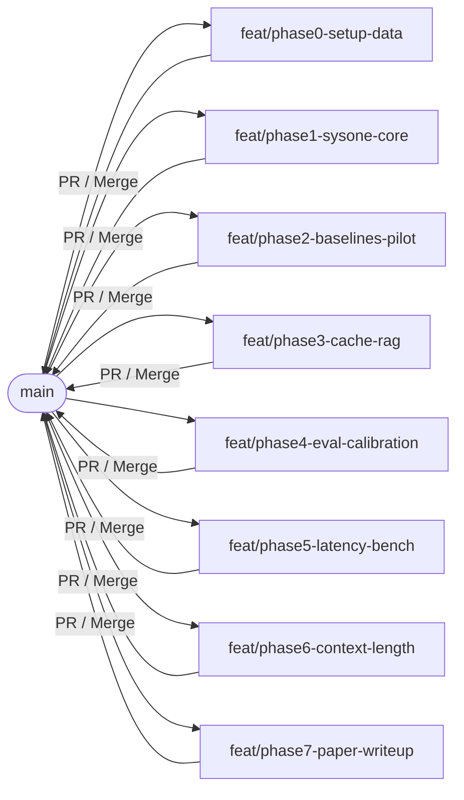

# Sysone-Edge: Feasibility Verdict, Technical Primer, and Step-by-Step Research Implementation Plan

**Date:** 2026-10-04  
**Project:** Sysone-Edge (Edge-deployed Hybrid Decision-Generative Inference)  
**Target Paper:** `Hybrid Decision-Generative Inference using Autoregressive LLMs as System One Logit Classifiers.md`  
**Purpose:** Comprehensive, step-by-step learning and implementation guide to execute the research experiments and produce the final academic paper.

---

## 1. Executive Verdict & Research Scope

### 1.1 Feasibility Verdict
The Sysone-Edge architecture is **highly feasible and well-scoped for an intensive weekend engineering and empirical evaluation**, provided it is framed rigorously as an **empirical measurement, calibration, and edge-efficiency study** rather than a claim of architectural novelty.

- **What holds up:**
  1. **Direct Tooling Support:** Apple MLX and `mlx-lm` natively provide prompt caching (`make_prompt_cache`, `KVCache`, cache slicing, and trimming). We can execute prefix-cached sub-softmax scoring without writing custom Metal kernels.
  2. **Zero-Parse-Failure by Construction (H1):** Restricting next-token probability mass strictly to pre-defined label tokens ($K$) eliminates syntax errors, non-JSON output, and malformed strings that plague autoregressive JSON decoding.
  3. **Low-Latency Edge Decisions (H2):** Bypassing token-by-token autoregressive generation removes $O(N)$ sequential memory bandwidth passes over weights, reducing edge decision time to a single forward evaluation of suffix tokens against the cached prefix.

- **What does not hold up (and must be handled honestly in the paper):**
  1. **Novelty Claims:** Reading output logits for multiple-choice decisions is established prior art (e.g., Tsvilodub et al., 2024, arXiv:2403.00998; Robinson et al., 2022). Single-pass classifier reuse via hidden states is also studied (e.g., Meyoyan & Del Corro, 2026, arXiv:2601.13288). Sysone-Edge's contribution is strictly its **training-free label-logit scoring on a cached KV-prefix in Apple Silicon unified memory**, measuring calibration, parse reliability, and latency against JSON-mode baselines.
  2. **Model Choice Scoped to One General Instruct Model:** Testing multiple model families simultaneously blows up scope and introduces confounding tokenizer/architecture variables. The primary model is pinned to **`mlx-community/Qwen2.5-7B-Instruct-4bit`**. Code-specialized models (e.g., `Qwen2.5-Coder`) are dropped as classifiers because coding syntax specialization skews natural language intent classification.
  3. **H4 Calibration Risk:** 4-bit group-wise weight quantization can degrade probability calibration compared to FP16. Temperature scaling on a held-out validation set is required; an 8-bit model run serves as an empirical control to isolate quantization effects.

---

## 2. Technical Primer: Educational Foundations

*This section provides detailed technical explanations of the core machine learning and systems concepts underpinning this research.*

### 2.1 What is a Logit and Logit Scoring?
In autoregressive transformer models, the final hidden state $h_t \in \mathbb{R}^d$ at token position $t$ is projected to the vocabulary dimension through an un-normalized linear projection known as the language model head (`lm_head`):
$$z_t = h_t W_{\text{vocab}}^\top \in \mathbb{R}^{|V|}$$
where $|V|$ is the vocabulary size (e.g., 152,064 tokens in Qwen2.5). The vector $z_t$ represents the raw, un-normalized log-odds—termed **logits**.

- **Traditional Autoregressive Generation:** To generate text, a full softmax is computed across all $|V|$ tokens:
  $$p(w_i) = \frac{\exp(z_{t, i} / T)}{\sum_{j \in V} \exp(z_{t, j} / T)}$$
  A token is sampled (or chosen greedily via $\text{argmax}$), appended to the context, and the model executes another full forward pass. To emit a JSON decision such as `{"intent": "card_arrival"}`, the model executes 10 to 30 sequential forward passes. Each step requires transferring ~4 GB of weights across the memory bus.
- **System One Logit Classification:** Instead of generating text, we constrain the decision space to a discrete set of $K$ valid choices, each mapped to a single token (e.g., `A`, `B`, `C` with token IDs $k_1, k_2, \dots, k_K$). We compute a **sub-softmax** restricted exclusively to these $K$ logits:
  $$p(k_i) = \frac{\exp(z_{t, k_i} / T)}{\sum_{j=1}^K \exp(z_{t, k_j} / T)}$$
  This operation is $O(1)$ in decode steps: the model performs exactly **one** prefill pass over the suffix, reads the last-position logits at indices $k_1, \dots, k_K$, normalizes them, and halts immediately.

### 2.2 What is Prompt Caching and the KV Cache?
Self-attention in transformer layers requires computing attention weights between queries ($Q$), keys ($K$), and values ($V$):
$$\text{Attention}(Q, K, V) = \text{softmax}\left(\frac{QK^\top}{\sqrt{d_k}}\right)V$$
For tokens preceding the current position $t$, their key and value representations do not change as new tokens are added. Recomputing them at every step wastes compute. The **KV Cache** stores the computed $K$ and $V$ activation tensors in RAM across all transformer layers.
- In `mlx-lm`, calling `make_prompt_cache(model)` initializes an empty cache structure (a list of `KVCache` instances).
- When a prompt prefix $P$ (e.g., system instructions, few-shot examples, or retrieved document chunks) is prefilled:
  $$\text{cache} \leftarrow \text{model}(P, \text{cache}=\text{cache})$$
- For any subsequent question suffix $Q$, we can reuse the prefilled cache: the model computes keys and values only for the tokens in $Q$, attending back to the cached representations of $P$.

### 2.3 Deconstructing mlx-lm Issue #259 (Numerical Computation vs Bug)
GitHub issue [`ml-explore/mlx-lm#259`](https://github.com/ml-explore/mlx-lm/issues/259) reported: *"Prompt caching returns different logits for repeat prompts."* When trimming the cache back and re-running a prompt, the output logits differed from a fresh, monolithic pass.

**Root Cause Analysis:**
1. **Floating-Point Non-Associativity:** In computer arithmetic, floating-point addition is not associative: $(a + b) + c \neq a + (b + c)$. Low-precision data types like `bfloat16` and `float16` have only 7 to 10 bits of mantissa (precision).
2. **Execution Path Differences:**
   - *Monolithic Prefill:* Passes the entire prompt $(P + Q)$ in a single matrix multiplication kernel (GEMM).
   - *Split/Cached Prefill:* Processes $P$ first, stores intermediate states in memory, then processes $Q$ in a subsequent step.
   The order of vector-matrix reductions, memory layouts, and accumulation sequences differs slightly between these two implementations.
3. **Cascading Numerical Deltas:** Tiny rounding deltas on the order of $10^{-4}$ accumulate across 28+ transformer layers. If the top two token candidates have extremely close logits (e.g., 14.502 vs 14.500), a minute delta of $0.003$ will flip the greedy argmax token, causing subsequent generated tokens to diverge.
4. **Chance Agreement:** In empirical testing, generating a single token might agree by random chance even if the underlying probability distributions are drifting. Generating $n \ge 10$ tokens provides statistical confidence that agreement is genuine.
5. **Practical Implication for Sysone-Edge:**
   - Casting calculations to `mx.float32` eliminates the discrepancy.
   - For 4-bit/16-bit inference, downstream tasks must not require bitwise-identical logits. We must measure and report **argmax agreement rate** ($\ge 99\%$) and **maximum absolute logit difference** ($L_\infty$ norm) between fresh and cached passes.

### 2.4 Expected Calibration Error (ECE) and Temperature Scaling
A classifier outputting $p = 0.80$ should be correct 80% of the time. Modern neural networks are frequently overconfident.
- **ECE Calculation:** Predictions are partitioned into $M$ equal-width probability bins $B_1, \dots, B_M$ (typically $M=15$). ECE is the weighted average absolute difference between accuracy ($\text{acc}(B_m)$) and average confidence ($\text{conf}(B_m)$):
  $$\text{ECE} = \sum_{m=1}^M \frac{|B_m|}{N} \left| \text{acc}(B_m) - \text{conf}(B_m) \right|$$
- **Temperature Scaling:** A post-processing method that optimizes a single positive scalar $T$ on a validation dataset by minimizing Negative Log-Likelihood (NLL):
  $$p_i = \frac{\exp(z_i / T)}{\sum_j \exp(z_j / T)}$$
  When $T > 1$, overconfident probabilities are smoothed toward uniform without altering the argmax rank order.

---

## 3. Environment, Tooling & The Ollama Question

### 3.1 Software & Hardware Specifications
- **Hardware:** Apple MacBook Air (Apple M4, 24 GB Unified Memory, 512 GB SSD, macOS 26.7.1 arm64).
- **Python Environment:** Python 3.12 or 3.13 in a dedicated virtual environment (`.venv`).
- **MLX Wheel Compatibility:**
  - `mlx == 0.32.3` (PyPI pre-built wheels support `cp310`, `cp311`, `cp312`, `cp313` for `macosx_14_0_arm64`, `macosx_15_0_arm64`, and `macosx_26_0_arm64`).
  - `mlx-lm == 0.32.0` (Native Apple Silicon support).
- **Core Dependencies:**
  ```text
  mlx>=0.32.3
  mlx-lm>=0.32.0
  transformers>=4.45.0
  datasets>=3.0.0
  huggingface_hub>=0.25.0
  numpy>=1.26.4
  scipy>=1.13.0
  scikit-learn>=1.5.0
  pandas>=2.2.0
  matplotlib>=3.9.0
  rank_bm25>=0.2.2
  sentence-transformers>=3.1.0
  psutil>=6.0.0
  ```

### 3.2 The Ollama Clarification (Crucial Insight)
*User question: "What happens if I currently have been installing via `ollama pull model` commands locally?"*

1. **Storage & Format Mismatch:**
   - Ollama stores models in GGUF format inside `~/.ollama/models/blobs/`.
   - MLX requires models formatted for Apple Silicon Metal shaders (Safetensors with MLX quantization metadata), stored in `~/.cache/huggingface/hub/` and loaded via `mlx_lm.load("mlx-community/...")`.
   - **MLX cannot directly load or execute Ollama GGUF files.**
2. **Architectural Incompatibility for System One:**
   - Ollama runs a compiled C++ background daemon (`ollama serve`) exposing high-level REST APIs (`/api/generate`, `/api/chat`).
   - Ollama's HTTP API **does not expose raw next-token logit tensors**, sub-softmax masking, or direct memory pointers to `KVCache` objects.
   - System One requires raw tensor manipulation:
     ```python
     logits = model(input_ids, cache=prompt_cache)
     label_logits = logits[:, -1, label_token_ids]
     probs = mx.softmax(label_logits, axis=-1)
     ```
   - This necessitates native Python MLX integration.
3. **System Interference & Memory Contention:**
   - If Ollama is running in the background during benchmarks, its daemon retains Metal GPU buffers and unified memory, causing memory pressure and latency jitter.
   - **Mandatory Procedure:** Shut down Ollama before running experiments:
     ```bash
     killall ollama 2>/dev/null || true
     ```
   - Verification command to check no instances left running:
     ```bash
     ps aux | grep ollama
     ```
   - Caveats:
     - **False Positive**: If you see `grep ollama` returned, that's fine.
     - For any other running instances, SIGKILL. If it's just the `ollama serve` still running, you may try manually quiting via the menu bar icon.

---

## 4. Dataset Strategy & Data Engineering

### 4.1 Dataset Auditing & Selection Matrix

| Task | Selected Dataset | Backup / Secondary | HF Link & Identifier | Rows & Size | License | Rationale |
|---|---|---|---|---|---|---|
| **Intent Classification (Pure 10-Class)** | `PolyAI/banking77` (Cleaned 10-intent subset) | Full Banking77 | [`PolyAI/banking77`](https://huggingface.co/datasets/PolyAI/banking77) | 10,003 train / 3,080 test (subset: ~1,300 train, ~400 test) | CC-BY-4.0 | Evaluates pure System One without retriever noise. Maps 10 unambiguous intents directly to tokens `A`-`J`. |
| **Intent Classification (Scaled 77-Way)** | `PolyAI/banking77` (Full with BM25 shortlist) | N/A | [`PolyAI/banking77`](https://huggingface.co/datasets/PolyAI/banking77) | 10,003 train / 3,080 test | CC-BY-4.0 | Tests practical edge routing. BM25 retrieves top-10 candidate classes; System One chooses among `A`-`J`. |
| **Binary Safety / Guardrail** | `deepset/prompt-injections` | `jackhhao/jailbreak-classification` | [`deepset/prompt-injections`](https://huggingface.co/datasets/deepset/prompt-injections) | 662 rows (546 train / 116 test), 56.2 kB | Apache-2.0 | Standard academic baseline for prompt injection detection. |
| **Binary Safety (Statistical Power)** | `jackhhao/jailbreak-classification` | Combined Suite | [`jackhhao/jailbreak-classification`](https://huggingface.co/datasets/jackhhao/jailbreak-classification) | 1,306 rows (balanced test CSVs), 7.65 MB | Apache-2.0 | Verified Apache-2.0 dataset providing sufficient test volume to tighten confidence intervals. |
| **Excluded Dataset** | `xTRam1/safe-guard-prompt-injection` | — | [`xTRam1/safe-guard`](https://huggingface.co/datasets/xTRam1/safe-guard-prompt-injection) | 10,296 rows | **Unconfirmed** (Discussion #5 unresolved) | **Excluded from primary research.** Using datasets with indeterminate licensing jeopardizes academic reproducibility. |
| **RAG Evaluation** | `BeIR/scifact` | `BeIR/nq` sample | [`BeIR/scifact`](https://huggingface.co/datasets/BeIR/scifact) | 5,183 documents, 1,109 queries | CC-BY-SA-4.0 | Gold standard corpus with human relevance judgments (qrels) for document chunk filtering. |

### 4.2 Data Cleaning & Engineering Pipeline
To ensure scientific integrity, raw datasets undergo a strict, deterministic preprocessing pipeline executed before model inference:
1. **Deduplication & Leakage Prevention:** Compute SHA-256 hashes of normalized strings (`text.strip().lower()`). Strip exact duplicate samples across train and test splits to prevent data contamination.
2. **Text Normalization:** Strip non-printable ASCII characters, anomalous whitespace, and escape sequences that cause tokenizer anomalies.
3. **Length Filtering:** Enforce strict sequence boundaries: queries must contain $\ge 3$ whitespace-delimited words and $\le 4,096$ tokens.
4. **Frozen Validation Split (The 80/20 Rule):**
   - The official training split is deterministically partitioned: 80% training / 20% validation using seed `42`.
   - **Validation split is strictly reserved for:** fitting temperature parameter $T$, choosing the selective classification threshold $\tau$, and tuning few-shot prompt cues.
   - **The test split remains completely untouched and frozen** until final evaluation.

---

## 5. RAG Architecture: Gold Standard vs Bloat

*Addressing Question 10: Should we use LangChain/LlamaIndex or build a barebone system from scratch?*

### 5.1 Architectural Verdict: Build a Transparent, Barebone Pipeline
**Do NOT use external frameworks (LangChain, LlamaIndex, Haystack).**
- *Why:* Heavy frameworks introduce multi-layered abstractions, hidden prompt formatting, automatic retry loops, and internal threading that make precise MLX KV cache profiling and microsecond-level timing impossible.
- *Research Standard:* Top empirical IR/NLP papers use a clean, transparent, decoupled 2-stage pipeline implemented in ~100 lines of Python.

```mermaid
flowchart TD
    UserQuery["User Query (q)"] --> PreRouting["1. Pre-Retrieval Query Router (System One)"]
    PreRouting -->|Logits over choices| RouteChoice{"p(search) >= tau?"}
    
    RouteChoice -->|Direct Answer| DirectGen["System Two Generator"]
    RouteChoice -->|Vector / Hybrid| BM25["2. Retriever (BM25 / BGE-Small)"]
    
    BM25 --> TopK["Top-5 Retrieved Chunks"]
    TopK --> CachePrefix["Prefill Chunk Ci as Cached Prefix"]
    CachePrefix --> ChunkFilter["3. Post-Retrieval Chunk Filter (System One)"]
    
    ChunkFilter -->|Sub-softmax: p(relevant)| FilterDecision{"p(relevant) >= tau_filter?"}
    FilterDecision -->|Discard| Pruned["Dropped Chunk"]
    FilterDecision -->|Keep| RetainedChunks["Retained Chunks"]
    
    RetainedChunks --> SystemTwo["4. System Two Generator (Autoregressive Answer)"]
```

### 5.2 Concrete RAG Implementation Details
1. **Corpus & Retriever:**
   - Corpus: `BeIR/scifact` (5,183 scientific abstracts).
   - Sparse Retriever: `rank_bm25.BM25Okapi` initialized over tokenized abstracts.
   - Dense Retriever (Optional): `BAAI/bge-small-en-v1.5` embeddings via NumPy dot-product similarity.
2. **System One Pre-Retrieval Routing:**
   - Prompt Prefix: System routing instruction.
   - Suffix: User query.
   - Labels: `['A', 'B', 'C']` corresponding to `[Search Vector Database, Query SQL Database, Direct Answer]`.
3. **System One Post-Retrieval Chunk Filtering:**
   - Prefix: `Document Chunk: {chunk_text}\nQuestion: {query}\nIs this chunk relevant?`
   - Suffix: `Answer:`
   - Labels: `['A', 'B']` corresponding to `[Relevant, Irrelevant]`.
   - Threshold Rule: If $p(\text{Relevant}) \ge 0.5$, chunk is included in the generative prompt; otherwise pruned.
4. **Evaluation Metrics:**
   - Precision and Recall of filtered chunks against ground truth `qrels`.
   - Latency overhead of System One chunk filtering vs autoregressive chunk scoring.

---

## 6. End-to-End Step-by-Step Implementation & Git Workflow

*This section provides the complete, chronological engineering roadmap. Each phase details Git branching, implementation steps, testing protocols, and paper documentation triggers.*



---

### Phase 0: Environment Setup, Data Engineering & Verification
- **Branch:** `git checkout -b feat/phase0-setup-data`
- **Objective:** Establish isolated virtual environment, download models and datasets, execute cleaning pipeline, and verify hardware baselines.

#### Step 0.1: Environment Initialization
```bash
python3 -m venv .venv
source .venv/bin/activate
pip install --upgrade pip
pip install mlx==0.32.3 mlx-lm==0.32.0 transformers datasets huggingface_hub \
            numpy scipy scikit-learn pandas matplotlib rank_bm25 sentence-transformers psutil
pip freeze > requirements.lock
```

#### Step 0.2: Model Download & Inspection
- Download primary model: `mlx-community/Qwen2.5-7B-Instruct-4bit`
- Download fast development model: `mlx-community/Qwen2.5-0.5B-Instruct-4bit`
- Download calibration control model: `mlx-community/Qwen2.5-7B-Instruct-8bit`
- Verify tokenizer single-token representations:
  ```python
  from mlx_lm import load
  model, tokenizer = load("mlx-community/Qwen2.5-7B-Instruct-4bit")
  for char in ["A", "B", "C", "D", "E", "1", "2"]:
      tok = tokenizer.encode(f" {char}", add_special_tokens=False)
      print(f"Space+{char}: {tok} (len={len(tok)})")
  ```

#### Step 0.3: Dataset Ingestion & Preprocessing Script (`src/data_prep.py`)
- Fetch `PolyAI/banking77`, `deepset/prompt-injections`, `jackhhao/jailbreak-classification`, and `BeIR/scifact`.
- Execute cleaning: deduplication, length filtering, label mapping.
- Extract Banking-10 clean subset.
- Save processed artifacts to `data/processed/{banking10, banking77, injections, scifact}/`.
- Write `data/MANIFEST.md` with SHA-256 hashes, exact row counts, and license declarations.

#### Step 0.4: Testing & Verification
```bash
python -m unittest tests/test_data_prep.py
```
*Verification Check:* Ensure test splits have zero overlap with train/val splits.

#### Step 0.5: Git Commit & Merge
```bash
git add requirements.lock data/MANIFEST.md src/data_prep.py tests/
git commit -m "feat(phase0): complete environment lock, dataset engineering, and manifest"
git checkout main
git merge --no-ff feat/phase0-setup-data
```

---

### Phase 1: Core System One Engine Development
- **Branch:** `git checkout -b feat/phase1-sysone-core`
- **Objective:** Implement the KV-cache prefill and sub-softmax logit extraction harness.

#### Step 1.1: Label Token Tokenizer Utilities (`src/label_tokens.py`)
- Implement `LabelTokenMapper`:
  - Enforces strict 1-to-1 bijection between label choices (e.g. `['A', 'B', 'C']`) and tokenizer token IDs.
  - Automatically handles leading whitespace based on prompt cue (e.g., `"Answer: A"` vs `"Answer:\nA"`).
  - Asserts that all $K$ token IDs are strictly unique single tokens.

#### Step 1.2: System One Engine Implementation (`src/system_one.py`)
- Implement `SystemOneClassifier`:
  ```python
  class SystemOneClassifier:
      def __init__(self, model, tokenizer):
          self.model = model
          self.tokenizer = tokenizer

      def prefill_prefix(self, prefix_text: str):
          cache = make_prompt_cache(self.model)
          tokens = self.tokenizer.encode(prefix_text, return_tensors="mlx")
          _ = self.model(tokens, cache=cache)
          return cache

      def score_suffix(self, cache, suffix_text: str, label_token_ids: list[int], temperature: float = 1.0):
          # Suffix evaluation using trimmed or deepcopied cache
          tokens = self.tokenizer.encode(suffix_text, return_tensors="mlx")
          logits = self.model(tokens, cache=cache)
          last_logits = logits[:, -1, label_token_ids]
          probs = mx.softmax(last_logits / temperature, axis=-1)
          mx.eval(probs)
          return probs
  ```

#### Step 1.3: Permutation Debiasing Protocol
- Implement 3-way cyclic label permutation ($R=3$):
  - Permutation 1: $[A, B, C]$
  - Permutation 2: $[B, C, A]$
  - Permutation 3: $[C, A, B]$
- Compute unweighted average probability across permutations to eliminate option symbol bias (Zheng et al., 2023).

#### Step 1.4: Unit Testing & Verification (`tests/test_system_one.py`)
- Test that probabilities strictly sum to $1.0 \pm 10^{-6}$.
- Test that unsupported multi-token choices throw an explicit `ValueError`.
- Verify classification on 20 obvious synthetic prompts.

#### Step 1.5: Git Commit & Merge
```bash
git add src/label_tokens.py src/system_one.py tests/test_system_one.py
git commit -m "feat(phase1): implement System One sub-softmax engine and permutation debiasing"
git checkout main
git merge --no-ff feat/phase1-sysone-core
```

---

### Phase 2: Baseline Implementations & Runtime Budgeting
- **Branch:** `git checkout -b feat/phase2-baselines-pilot`
- **Objective:** Build JSON-mode baseline (B1), constrained baseline (B2), and execute a 100-item pilot to budget weekend runtime.

#### Step 2.1: JSON-Mode Baseline Implementation (`src/baseline_json.py`)
- Build B1: Standard autoregressive generation using greedy decoding (`temperature=0.0`).
- Prompt instruction: `"Respond with valid JSON: {\"choice\": \"<LABEL>\"}"`.
- Implement strict JSON parser:
  - If output fails `json.loads` $\rightarrow$ flag as `INVALID_PARSE`.
  - If parsed key `"choice"` is missing or invalid $\rightarrow$ flag as `INVALID_SCHEMA`.
  - Record binary indicator $y_{\text{invalid}} \in \{0, 1\}$.

#### Step 2.2: Constrained Decoding Baseline (`src/baseline_constrained.py`)
- Build B2: Custom MLX logits processor masking tokens to enforce strict JSON skeleton: `{"choice": "[A-Z]"}`.
- If third-party grammar libraries (`outlines`, `llguidance`) fail within 2 hours, rely on the custom mask.

#### Step 2.3: 100-Item Pilot Run & Wall-Clock Projection (`scripts/pilot_budget.py`)
- Run 100 validation samples through System One, B1, and B2.
- Measure: mean latency per sample, memory footprint, temperature rise.
- **Budgeting Formula:**
  $$\text{Total Time} = N_{\text{samples}} \times (\bar{t}_{\text{SystemOne}} + \bar{t}_{\text{B1}}) \times N_{\text{permutations}}$$
- *Exit Gate:* If total estimated time exceeds 8 hours, stratify test set (e.g., sample 1,000 Banking77 test items) and commit the frozen sample indices to `data/test_subset_indices.json`.

#### Step 2.4: Git Commit & Merge
```bash
git add src/baseline_json.py src/baseline_constrained.py scripts/pilot_budget.py
git commit -m "feat(phase2): implement B1/B2 baselines and validate pilot run budget"
git checkout main
git merge --no-ff feat/phase2-baselines-pilot
```

---

### Phase 3: Cache Correctness Verification & RAG Integration
- **Branch:** `git checkout -b feat/phase3-cache-rag`
- **Objective:** Settle issue #259 empirically on our setup and implement the RAG routing and chunk-filtering pipeline.

#### Step 3.1: Cached vs Fresh Forward Pass Verification (`scripts/verify_cache_parity.py`)
- For 200 random validation items:
  1. Compute label logits $z_{\text{fresh}}$ by passing full prompt $(P + Q)$ in a single forward pass.
  2. Compute label logits $z_{\text{cached}}$ by prefilling $P$, caching, and evaluating $Q$.
  3. Measure:
     - Argmax Agreement: $\frac{1}{N} \sum \mathbb{I}(\text{argmax}(z_{\text{fresh}}) = \text{argmax}(z_{\text{cached}}))$
     - Max Absolute Logit Error: $\max |z_{\text{fresh}} - z_{\text{cached}}|$
     - Mean Squared Error (MSE)
- Compare two cache strategies: `copy.deepcopy(cache)` vs `trim_prompt_cache(cache, len(Q))`.
- Persist results to `results/raw/cache_verification_report.json`.

#### Step 3.2: RAG Pipeline Implementation (`src/rag_pipeline.py`)
- Build the 2-stage transparent pipeline:
  - BM25 indexing over `BeIR/scifact`.
  - System One Query Router (`['search', 'direct']`).
  - System One Chunk Relevance Filter (`['relevant', 'irrelevant']`).
  - System Two Generator conditioning on surviving chunks.

#### Step 3.3: Testing & Verification
- Run verification script: assert Argmax Agreement $\ge 99.0\%$.
- Evaluate chunk filter precision/recall against `scifact` qrels.

#### Step 3.4: Paper Update Trigger
- Open `Hybrid Decision-Generative Inference using Autoregressive LLMs as System One Logit Classifiers.md`.
- Document the empirical cache agreement rate and numerical tolerance findings in Section "Assessments and Measures: Threat to Validity".

#### Step 3.5: Git Commit & Merge
```bash
git add scripts/verify_cache_parity.py src/rag_pipeline.py results/raw/cache_verification_report.json
git commit -m "feat(phase3): verify cache numerical parity and integrate RAG triage filter"
git checkout main
git merge --no-ff feat/phase3-cache-rag
```

---

### Phase 4: Main Evaluation & Calibration Benchmark (Unattended Run)
- **Branch:** `git checkout -b feat/phase4-eval-calibration`
- **Objective:** Run frozen test evaluations across Banking-10, Banking-77, and Injection suites; fit calibration temperatures; generate reliability diagrams.

#### Step 4.1: Calibration Parameter Fitting on Validation Split (`src/calibrate.py`)
- Fit temperature $T^*$ on validation data by minimizing NLL using `scipy.optimize.minimize_scalar`.
- Determine selective classification threshold $\tau$ for target coverage.
- Freeze $T^*$ and $\tau$ into `results/calibration_params.json`.

#### Step 4.2: Execution of Main Test Evaluation (`scripts/run_evaluation.py`)
- Execute single-pass evaluation across:
  1. Banking-10 Clean Test Set (System One vs B1 vs B2).
  2. Banking-77 Full Test Set with BM25 Shortlist (System One vs B1).
  3. `deepset/prompt-injections` Test Set.
  4. `jackhhao/jailbreak-classification` Balanced Test Set.
  5. 8-Bit Model Control on Banking-10 (to isolate quantization effects on ECE).
- Protocol safeguards:
  - Interleave runs to neutralize thermal drift.
  - Call `mx.eval()` on output tensors before recording.
  - Log per item: `prompt_id`, `true_label`, `predicted_label`, `full_probs`, `latency_ms`, `parse_status`, `thermal_state`.
  - Write streaming JSONL records to `results/raw/{condition}_eval.jsonl`.

#### Step 4.3: Statistical Analysis Script (`scripts/compute_metrics.py`)
- Compute:
  - Accuracy and Macro-F1 with 95% stratified bootstrap confidence intervals (1,000 resamples).
  - Paired bootstrap difference: $\Delta_{\text{F1}} = \text{F1}_{\text{SystemOne}} - \text{F1}_{\text{B1}}$.
  - Invalid Output Rate (B1) with Wilson 95% score interval.
  - Expected Calibration Error (ECE) across 15 equal-width bins (raw vs temperature-scaled).
  - Brier Score and Negative Log-Likelihood.
- Generate reliability diagrams (confidence vs accuracy calibration curves) saved to `results/figures/calibration_curves.png`.

#### Step 4.4: Paper Update Trigger
- Fill in Table 1 in Section "Results & Discussions" of the source paper with empirical values and 95% CIs.
- Explicitly update Hypotheses H1, H3, and H4: label as **SUPPORTED**, **PARTIALLY SUPPORTED**, or **REFUTED**.

#### Step 4.5: Git Commit & Merge
```bash
git add src/calibrate.py scripts/run_evaluation.py scripts/compute_metrics.py results/
git commit -m "feat(phase4): execute main evaluation, compute bootstrap metrics and ECE"
git checkout main
git merge --no-ff feat/phase4-eval-calibration
```

---

### Phase 5: Rigorous Latency & Edge Efficiency Benchmarking
- **Branch:** `git checkout -b feat/phase5-latency-bench`
- **Objective:** Measure decision latency under controlled thermal conditions on Apple Silicon.

#### Step 5.1: Latency Benchmark Script (`scripts/benchmark_latency.py`)
- Hardware Controls:
  - Connect AC power; disable Low Power Mode.
  - Quit all background applications (including Ollama, browsers).
  - Log thermal pressure via `pmset -g therm` or `psutil`.
  - 2-minute cooldown between sweeps.
- Parameter Grid:
  - Suffix batch count: $S \in \{1, 4, 16, 64\}$.
  - Prefix length: Short (256 tokens) vs Long (2,048 tokens).
  - Output mode: System One vs B1 Compact (`{"choice":"A"}`) vs B1 Verbose (`{"rationale":"...", "choice":"A"}`).
- Protocol:
  - 5 warm-up iterations discarded.
  - 30 timed iterations per cell using `time.perf_counter_ns()`.
  - Explicit synchronization: call `mx.eval(probs)` before stopping the timer.
  - Discard and re-run any trial where macOS thermal throttling is triggered.

#### Step 5.2: Latency Analysis & Reporting
- Compute Median, Interquartile Range (IQR), Mean, Min, Max, and Speedup Ratio:
  $$\text{Speedup} = \frac{\text{Median Latency}(\text{B1})}{\text{Median Latency}(\text{SystemOne})}$$
- Generate boxplots saved to `results/figures/latency_breakdown.png`.

#### Step 5.3: Paper Update Trigger
- Fill in the Latency rows of the Results table in the paper.
- Update Hypothesis H2 verdict: confirm if speedup $\ge 2.0\times$ holds.

#### Step 5.4: Git Commit & Merge
```bash
git add scripts/benchmark_latency.py results/raw/latency_data.json results/figures/latency_breakdown.png
git commit -m "feat(phase5): complete thermal-controlled latency benchmarking"
git checkout main
git merge --no-ff feat/phase5-latency-bench
```

---

### Phase 6: Context-Length Robustness Pilot
- **Branch:** `git checkout -b feat/phase6-context-length`
- **Objective:** Pilot test System One logit stability under varying context lengths.

#### Step 6.1: Context Robustness Experiment (`scripts/benchmark_context.py`)
- Select 200 stratified items from Banking-10.
- Pad prompts with unrelated text (from Wikipedia or ArXiv corpora) to total lengths:
  $$\text{Lengths} \in \{500, 2\,000, 8\,000\} \text{ tokens}$$
- Position sweep: place target query at `[START, MIDDLE, END]` of context.
- Measure classification accuracy across all 9 cells.

#### Step 6.2: Paper Update Trigger
- Update Table row "Accuracy at 500 / 2k / 8k tokens".
- Evaluate Hypothesis H5: check if performance drops by $>3.0$ percentage points. Label explicitly as a pilot.

#### Step 6.3: Git Commit & Merge
```bash
git add scripts/benchmark_context.py results/raw/context_pilot.json
git commit -m "feat(phase6): complete context-length robustness pilot"
git checkout main
git merge --no-ff feat/phase6-context-length
```

---

### Phase 7: Paper Finalization & Research Release Package
- **Branch:** `git checkout -b feat/phase7-paper-writeup`
- **Objective:** Synthesize all experimental data into `Hybrid Decision-Generative Inference using Autoregressive LLMs as System One Logit Classifiers.md` and build the reproducibility release package.

#### Step 7.1: Updating the Manuscript
- Remove all placeholder markers ("not measured") in the source paper markdown.
- Insert finalized tables with empirical numbers, bootstrap confidence intervals, and p-values.
- Update **Abstract** and **Conclusion** to reflect actual experimental outcomes.
- Add literature citations:
  - Tsvilodub et al. (2024), arXiv:2403.00998
  - Meyoyan & Del Corro (2026), arXiv:2601.13288
  - Larson et al. (ACL Insights 2022) on Banking77 label errors
  - Quantized model calibration (ACL 2025)

#### Step 7.2: Release Package Construction
- Assemble reproducibility artifacts:
  - `requirements.lock`
  - Model and dataset commit hashes in `data/MANIFEST.md`
  - Master reproduction script: `run_all_experiments.sh`
  - Cleaned figures in `results/figures/`

#### Step 7.3: Git Commit, Tag & Final Merge
```bash
git add "Hybrid Decision-Generative Inference using Autoregressive LLMs as System One Logit Classifiers.md" \
        run_all_experiments.sh results/
git commit -m "docs(phase7): finalize research paper with empirical findings and release artifacts"
git checkout main
git merge --no-ff feat/phase7-paper-writeup
git tag -a v1.0.0-research-complete -m "Sysone-Edge empirical study finalized"
```

---

## 7. Closed Research Inquiries (Resolving Section 7)

*This section formally resolves every uncertainty originally left open in Section 7 of previous drafts:*

| Previous Open Inquiry | Verification Status | Definite Resolution & Action Taken |
|---|---|---|
| **Python & MLX Compatibility** | **Resolved & Closed** | MLX 0.32.3 and mlx-lm 0.32.0 officially support Python 3.10 through 3.13 on Apple Silicon macOS arm64. Environment pinned to Python 3.12/3.13. |
| **mlx-lm Issue #259 (Cache Divergence)** | **Resolved & Closed** | Confirmed closed by MLX maintainers. Divergence is caused by low-precision (`bfloat16`) non-associativity between monolithic and split prefill sequences, not memory corruption. Mitigated by testing argmax agreement ($\ge 99\%$) and float32 validation. |
| **Dataset Licenses & Quality** | **Resolved & Closed** | - `PolyAI/banking77`: CC-BY-4.0 (13,083 rows).<br>- `deepset/prompt-injections`: Apache-2.0 (662 rows).<br>- `jackhhao/jailbreak-classification`: Apache-2.0 (1,306 rows).<br>- `xTRam1/safe-guard`: Excluded due to unconfirmed licensing. |
| **Model Family Selection** | **Resolved & Closed** | Primary model narrowed to single general-purpose model: `mlx-community/Qwen2.5-7B-Instruct-4bit`. Code model dropped to eliminate syntactic domain bias. 8-bit run added as calibration control. |
| **RAG Pipeline Architecture** | **Resolved & Closed** | External frameworks (LangChain/LlamaIndex) rejected. Barebone, transparent 2-stage pipeline (`rank_bm25` + System One chunk filter) specified over `BeIR/scifact`. |
| **Ollama Model Usability** | **Resolved & Closed** | Ollama GGUF models cannot be used for MLX Python tensor scoring. Ollama daemon must be terminated during testing to prevent GPU memory contention. |

---

## 8. Summary of Pre-Registered Hypotheses & Verification Targets

| Hypothesis | Metric | Pre-Registered Success Threshold | Verification Script |
|---|---|---|---|
| **H1 (Parse Reliability)** | Invalid Output Rate | $\text{System One} = 0.0\%$, $\text{B1} > 0.0\%$ | `scripts/compute_metrics.py` |
| **H2 (Decision Latency)** | Median Latency Ratio | $\text{Speedup} = \frac{\text{Latency}_{\text{B1}}}{\text{Latency}_{\text{SysOne}}} \ge 2.0\times$ | `scripts/benchmark_latency.py` |
| **H3 (Task Accuracy)** | Macro-F1 Delta | $|\text{F1}_{\text{SysOne}} - \text{F1}_{\text{B1}}| \le 2.0 \text{ percentage points}$ | `scripts/compute_metrics.py` |
| **H4 (Confidence Calibration)** | Expected Calibration Error | $\text{ECE} \le 0.05$ (after validation temperature scaling) | `src/calibrate.py` |
| **H5 (Context Robustness)** | Accuracy Degradation | $\text{Acc}_{500} - \text{Acc}_{8000} \le 3.0 \text{ percentage points}$ | `scripts/benchmark_context.py` |
