# System One vs. System Two Inference Through the Lens of Modern Columnar Data Systems

**Author:** Bernard Chiang  
**Topic:** Edge LLM Optimization, Dual-Process Inference, and Database Systems Parallels  
**Target Length:** 2–3 Page Learning Brief

---

## 1. System One vs. System Two in Language Models

In cognitive psychology, Kahneman’s dual-process theory distinguishes between two modes of thought: **System 1** (fast, instinctive, bounded) and **System 2** (slow, deliberate, analytical). When mapped to autoregressive Large Language Models (LLMs), this distinction manifests as an architectural choice between **direct logit classification** and **open-ended sequence generation**.

Recall: 
- queries ($Q$), keys ($K$), and values ($V$): $$\text{Attention}(Q, K, V) = \text{softmax}\left(\frac{QK^\top}{\sqrt{d_k}}\right)V$$
- Prompt prefix, $P$ (e.g., system instructions, few-shot examples, or retrieved document chunks) is prefilled: $$\text{cache} \leftarrow \text{model}(P, \text{cache}=\text{cache})$$

```
                   ┌─────────────────────────────────────────────────────────────┐
                   │                      Input Context (P + Q)                  │
                   └──────────────────────────────┬──────────────────────────────┘
                                                  │
                                   Transformer Backbone Prefill
                                                  │
                                                  ▼
                                     Hidden State: h_t ∈ ℝ^d
                                                  │
                        ┌─────────────────────────┴─────────────────────────┐
                        ▼                                                   ▼
            [ SYSTEM ONE: DECISION ]                             [ SYSTEM TWO: DELIBERATION ]
      Restricted Sub-Softmax on K Logits                       Unconstrained Greedy / Sampled Decode
                        │                                                   │
             Direct Probability Mass                               Next Token w_t ~ Softmax(z_t)
            p(k_i) over discrete labels                                     │
                        │                                          Append w_t, loop N times...
                        ▼                                                   ▼
             Immediate Output: O(1) steps                        Generated String: O(N) steps
            (Zero parsing; zero syntax error)                 (e.g., JSON string -> json.loads())
```

### The Core Formulations

#### System Two: Autoregressive Sequential Decoding
To emit a structured decision (such as JSON `{"intent": "card_lost"}`), an autoregressive LLM projects the hidden state $h_t \in \mathbb{R}^d$ through the vocabulary projection head $W_v \in \mathbb{R}^{|V| \times d}$ to produce vocabulary logits $z_t$:

$$z_t = h_t W_v^\top \in \mathbb{R}^{|V|} \quad (|V| \approx 152,000 \text{ tokens})$$

The model computes the full categorical probability distribution over the entire vocabulary:

$$P(w_{t} = i) = \frac{\exp(z_{t, i} / T)}{\sum_{j \in V} \exp(z_{t, j} / T)}$$

It selects token $w_t$, appends it to the sequence, and repeats this process sequentially for $N$ decode cycles ($N \approx 15\text{--}30$ tokens for simple JSON).

#### System One: Direct Logit Classification
When the downstream task is a discrete classification (routing, tool selection, or guardrails), the output decision space is bounded *a priori* to a finite set of $K$ valid classes. Mapping each class to a single candidate token index $k_1, k_2, \dots, k_K \in V$, System One halts text generation entirely and evaluates a **sub-softmax** restricted strictly to the candidate indices:

$$P(\text{choice} = c) = \frac{\exp(z_{t, k_c} / T)}{\sum_{j=1}^K \exp(z_{t, k_j} / T)}$$

By construction, System One requires **$N = 0$ decode cycles**, incurs zero JSON syntax/parse errors, and yields a normalized probability distribution in a single step.

---

## 2. The Data Warehouse Analogy: Memory Bandwidth as the Bottleneck

To understand why System One is radically faster on physical hardware, we look at classical data systems: **Row-Oriented Relational Stores (OLTP)** versus **Columnar Analytical Engines (OLAP)**.

### The Physics of the Memory Wall
In both database query engines and modern AI accelerators (such as Apple Silicon unified memory), the dominant performance bottleneck is rarely raw compute arithmetic (ALU/FLOPs). It is **memory bus bandwidth**—the physical transfer of bytes from DRAM into high-speed on-chip cache and execution registers.

```mermaid
flowchart TD
    subgraph RowStore["Traditional Row-Store (e.g. Postgres Full Scan)"]
        R_Disk["Storage / RAM"] -->|"Stream Full Row [ID, Name, Email, Bio, Age]"| R_Bus["Memory Bus (Massive Bandwidth)"]
        R_Bus --> R_CPU["CPU Core / Cache"]
        R_CPU -->|"Discard Name, Email, Bio"| R_Out["Keep Age Column Only"]
    end

    subgraph ColumnarStore["Modern Columnar Engine (e.g. Parquet / ClickHouse)"]
        C_Disk["Storage / RAM"] -->|"Stream ONLY [Age] Array Block"| C_Bus["Memory Bus (Minimal Bandwidth)"]
        C_Bus --> C_CPU["Vectorized SIMD / GPU"]
        C_CPU -->|"Compute AVG(Age)"| C_Out["Final Aggregation"]
    end
```



### Visual: The Row vs. Column Memory Sweep

Consider an analytical query computing the average user age:  
`SELECT AVG(age) FROM users;`

```
--- ROW-STORE MEMORY LAYOUT (Scanning All Fields Contiguously) ---

Physical Memory Address Space:
  [ Row 0: ID | Alice   | alice@mail.com   | "Bio..." | Age: 28 ]
  [ Row 1: ID | Bob     | bob@work.org     | "Bio..." | Age: 34 ]
  [ Row 2: ID | Charlie | charlie@corp.io  | "Bio..." | Age: 42 ]

Memory Bus Stream (Bytes Moved):
  ==============================================================> (100% Data Streamed)
  [████████████████████████████████████████████████████████████]  ~3,000 bytes read
                                                            ▲
                                                            Only these 12 bytes needed!
  Result: 99.6% of memory bus traffic is thrown in the trash.


--- COLUMNAR MEMORY LAYOUT (Parquet / ClickHouse: Contiguous Slices) ---

Physical Memory Address Space:
  Array(ID):    [ ID_0  | ID_1  | ID_2  ]
  Array(Name):  [ Alice | Bob   | Charlie ]
  Array(Email): [ ...   | ...   | ...   ]
  Array(Age):   [ 28    | 34    | 42    ]  <-- Engine reads ONLY this contiguous block!

Memory Bus Stream (Bytes Moved):
  ======> (Only Requested Column Streamed)
  [████]  ~12 bytes read
  
  Result: 100% bus utilization efficiency. Zero wasted bandwidth.
```

---

## 3. Bridging Back: System One as Columnar Projection Pushdown

How does this database bottleneck map directly to edge LLM inference?

### The Memory Bandwidth Trap of Autoregressive Decoding
On Apple Silicon, unified memory bandwidth is shared between CPU and Metal GPU.
- **Prefill Phase (Prompt Ingestion):** Compute-bound (matrix-matrix multiplication, GEMM). Tokens are processed in parallel; arithmetic intensity is high.
- **Decode Phase (Token Generation):** Strictly **memory-bandwidth-bound** (matrix-vector multiplication, GEMV). 

To emit just **one single token**, the GPU cannot keep the entire model in registers. It must read the **entire 4.5 GB of model weights** (for a 4-bit 7B model) from DRAM across the memory bus:

$$\text{Memory Traffic per Token} \approx \text{Model Size (GB)} = 4.5 \text{ GB}$$

If System Two emits a 25-token JSON block `{"choice": "card_lost"}`, it forces:

$$25 \text{ tokens} \times 4.5 \text{ GB/token} = \mathbf{112.5 \text{ GB of memory bus traffic}}$$

All 112.5 GB of weight streaming occurs merely to extract a single categorical choice.

### Visual: LLM Output Memory Traffic

```
--- SYSTEM TWO: AUTOREGRESSIVE SERIAL MATERIALIZATION ---

Step  1: Stream 4.5 GB weights ---> Emit "{"
Step  2: Stream 4.5 GB weights ---> Emit "\"choice\""
Step  3: Stream 4.5 GB weights ---> Emit ":"
Step  4: Stream 4.5 GB weights ---> Emit "\"card_lost\""
Step  5: Stream 4.5 GB weights ---> Emit "}"
... (Repeated 25 times)

Total Memory Bus Transfer:
[4.5GB] + [4.5GB] + [4.5GB] + [4.5GB] + [4.5GB] ... = 112.5 GB Transferred!
===========================================================================>
                                                                         ▲
Application Layer parses string with json.loads() ────────────────────────┘


--- SYSTEM ONE: OUTPUT PROJECTION PUSHDOWN (Columnar Logit Scoring) ---

Step 1: Stream 4.5 GB weights ONCE (Prefill prompt prefix into KV Cache).
Step 2: Read hidden state h_t at final position.
Step 3: Slice lm_head weight matrix W_v strictly at candidate indices:
        W_sub = W_v[[k_1, k_2, k_3], :]   (Size: 3 × d)
Step 4: Sub-Softmax(h_t · W_sub^T) ---> [0.88, 0.09, 0.03] ---> HALT!

Total Memory Bus Transfer:
[4.5GB (Prefill)] + [0 GB Decode Sweeps] = 4.5 GB Transferred!
======>
Result: 25x reduction in memory bus traffic; 0 decode passes; instant execution.
```

---

## 4. Formal Database Concepts & Final Verdict

| Formal Database Concept | Traditional Data Warehouse Application | Edge LLM System One Equivalency |
|---|---|---|
| **Projection Pushdown** | SQL optimizer pushes `SELECT col` down to storage so unneeded table columns are never fetched into RAM. | The inference engine pushes the choice schema down to the `lm_head` tensor, so unneeded vocabulary tokens ($|V| - K$) and syntax strings are never computed or decoded. |
| **Avoided Materialization** | Query engine operates on compressed column vectors in registers without materializing full tuples into memory buffers. | System One operates directly on logit vectors in GPU registers without serializing internal states into string tokens and parsing them back. |
| **Bandwidth Amplification Factor** | Ratio of physical bytes scanned from disk versus actual data bytes required by the user query. | Ratio of total weights streamed across the memory bus (~112 GB) versus the actual entropy of the decision (~few bits). System One eliminates the amplification penalty. |

### Final Systems Verdict

> **When the consumer of an LLM's output is downstream software rather than a human reader, treating the model as an unconstrained text generator is the modern AI equivalent of executing a full row scan across an entire database to retrieve a single integer column.**

By recognizing that edge inference is memory-bandwidth-bound, System One reclaims efficiency through **output space projection pushdown**. It delivers deterministic, zero-parse-failure execution at the physical lower bound of hardware memory bandwidth.
